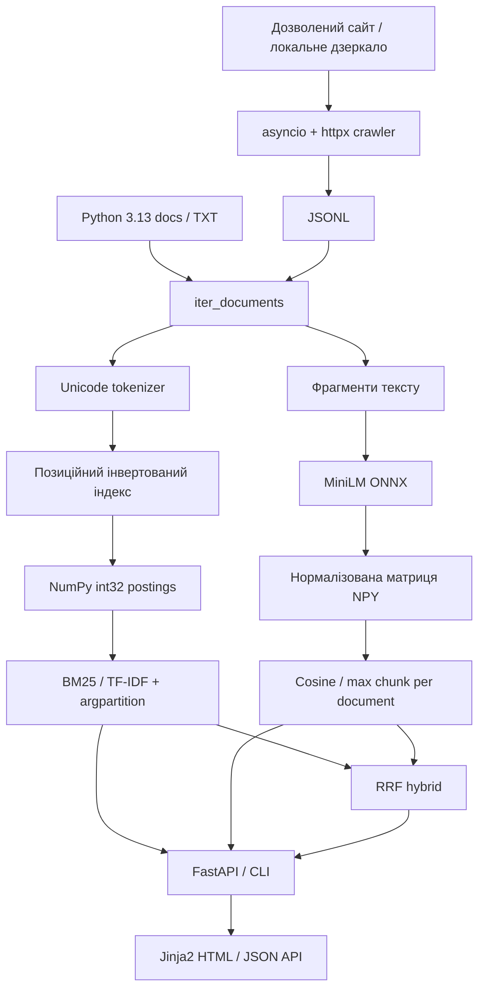
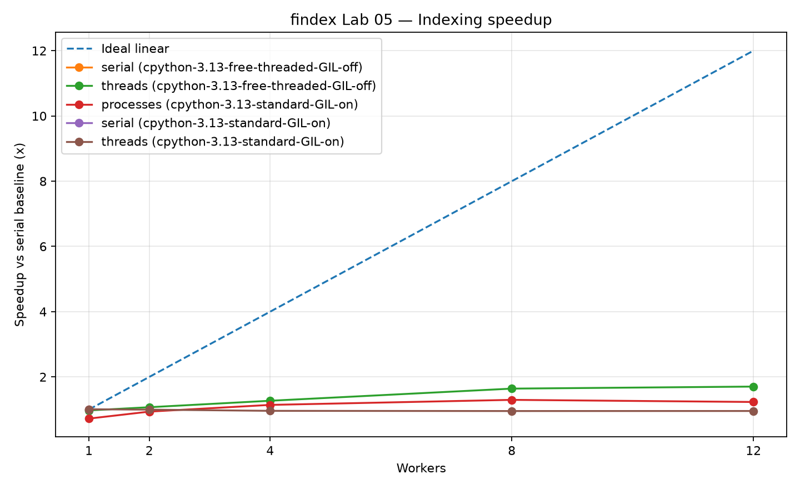

# findex — Python search engine

Пошукова система документації Python: Boolean, BM25/TF-IDF на NumPy, семантичний MiniLM і гібридний RRF-пошук через CLI та FastAPI.

**[Відкрити публічний сайт](https://findex-search-1n7g.onrender.com/)** · [API](https://findex-search-1n7g.onrender.com/docs) · [Health](https://findex-search-1n7g.onrender.com/health) · [CI](https://github.com/xaomi7301-ops/findex/actions)

Версія **1.0.0** працює на Render: публічний вебінтерфейс Lab 08, гібридний пошук та BM25 API перевірено 12.11.2026.

| Корпус | Публічний p95 BM25 (v1.0.0) | Найбільше прискорення скорера (Lab 08) |
|---:|---:|---:|
| **514 документів** | **1209.12 мс** | **10.89×** |

Демо GIF та відео: будуть додані після запису реального пошуку у браузері.  
Автор: Калініченко Олександр Олександрович. Навчальний проєкт, лабораторні 1–8.

## Швидкий старт

Python 3.13, Git, uv. Для Docker і створення ембедингів потрібен доступ до Інтернету.

```powershell
git clone https://github.com/xaomi7301-ops/findex.git
cd findex
uv sync --locked --python 3.13
uv run python scripts/download_python_docs.py
uv run findex index data/python_docs --out index.bin --positions --executor serial
uv run findex -v embed index.bin --corpus data/python_docs --threads 4
uv run findex search index.bin "how to run several tasks at the same time" --mode hybrid --corpus data/python_docs --k 5
```

Локальний вебсервер:

```powershell
$env:INDEX_PATH = "index.bin"
$env:CORPUS_PATH = "data/python_docs"
$env:EMBEDDINGS_PATH = "data/lab08/embeddings"
$env:MODEL_DIR = "data/lab08/model"
uv run findex serve --port 8000
```

Відкрийте http://127.0.0.1:8000/. На сторінці оберіть режим «За словами», «За змістом» або «Гібридний (RRF)». Зупинка: Ctrl+C.

Docker (окремий термінал, без запущеного локального сервера на 8000):

```powershell
docker build -t findex:1.0.0 .
docker run --rm -p 8000:8000 -e INDEX_PATH=/app/data/index.bin -e CORPUS_PATH=/app/data/python_docs -e EMBEDDINGS_PATH=/app/data/lab08/embeddings -e MODEL_DIR=/app/data/lab08/model findex:1.0.0
```

Docker створює індекс і ембединги у builder-етапі, runtime non-root.
На Windows Docker Desktop сторінка 1.0.0 та /health успішно відкрилися.
Гібридний запит `how to run several tasks at the same time` у Docker повернув
514 документів-кандидатів, HTTP 200, внутрішній took_ms 12.408 мс (один запит).
Перші результати: Thread-based parallelism, Coroutines and tasks,
Process-based parallelism. На Windows CLI перші два місця відрізнялися;
точну причину різниці не встановлено. На Render v1.0.0 той самий гібридний
запит повернув 514 кандидатів, перший результат Thread-based parallelism,
внутрішній took_ms 20.298 мс (один запит).

## Архітектура



Lexical: логічні AND/OR/NOT, дужки, фрази та BM25/TF-IDF. Semantic: природномовний запит англійською, найкращий фрагмент кожного документа. Hybrid: RRF з BM25 OR і cosine ranks, не сума сирих балів. API: /search, /docs/{doc_id}, /stats, /health. Swagger: /docs.

## Вимірювання Lab 08

Windows, AMD Ryzen 5 7430U (6 фізичних / 12 логічних ядер), Python 3.13.
Корпус: 514 документів, 1 921 193 токени, 41 255 термінів; 18 301 фрагмент × 384 float32. 

### Профілювання до оптимізації

| CLI | cProfile час, с | Виклики функцій | Scalene час, с |
|---|---:|---:|---:|
| index | 12.666 | 11 387 038 | 6.749 |
| search (3 терміни) | 1.854 | 2 841 452 | 1.469 |

[Гіпотези та розподіл Python/native/system](docs/LAB08_BASELINE.md) · [Flame graph index](docs/lab08-index-flame.svg) · [Flame graph search](docs/lab08-search-flame.svg).
cProfile включає CLI, I/O і завантаження pickle; це не час одного скорера.

### NumPy, медіани 100 повторів (top-10)

| Запит | Скорер | Python, мс | NumPy, мс | Прискорення |
|---|---|---:|---:|---:|
| the | BM25 | 0.6832 | 0.06295 | 10.85× |
| the | TF-IDF | 0.5273 | 0.0484 | 10.89× |
| frozenset | BM25 | 0.0429 | 0.03585 | 1.20× |
| frozenset | TF-IDF | 0.0339 | 0.0292 | 1.16× |
| python OR asyncio OR thread | BM25 | 0.7734 | 0.08565 | 9.03× |
| python OR asyncio OR thread | TF-IDF | 0.5831 | 0.0671 | 8.69× |

Числові буфери: 2 515 176 байтів, одноразове створення 342.60 мс.
Порівнюється однаковий набір кандидатів і результатів на вже завантаженому індексі.
Короткий список frozenset (23 документи) майже не амортизує накладні витрати NumPy.
[Сирі вимірювання](benchmarks/lab08-scorer.json) · [Аналіз](docs/LAB08_NUMPY.md).

### Precision@5: 15 запитів

| Запит | Група | BM25 AND | BM25 OR | Semantic | Hybrid |
|---|---|---:|---:|---:|---:|
| asyncio tasks | Lab 03 | 0.20 | 0.20 | 0.20 | 0.20 |
| regular expression | Lab 03 | 0.40 | 0.40 | 0.40 | 0.40 |
| json encoder | Lab 03 | 0.20 | 0.20 | 0.20 | 0.20 |
| pickle serialization | Lab 03 | 0.20 | 0.20 | 0.20 | 0.20 |
| pathlib paths | Lab 03 | 0.20 | 0.20 | 0.40 | 0.40 |
| functools cache | Lab 03 | 0.20 | 0.20 | 0.20 | 0.20 |
| threading lock | Lab 03 | 0.20 | 0.20 | 0.20 | 0.20 |
| unittest mock | Lab 03 | 0.20 | 0.20 | 0.20 | 0.20 |
| typing protocol | Lab 03 | 0.20 | 0.20 | 0.20 | 0.20 |
| collections counter | Lab 03 | 0.20 | 0.20 | 0.20 | 0.20 |
| juggling chores | Paraphrase | 0.00 | 0.00 | 0.00 | 0.00 |
| wildcarded patternmatching | Paraphrase | 0.00 | 0.00 | 0.00 | 0.00 |
| interoperable payload marshalling | Paraphrase | 0.00 | 0.00 | 0.00 | 0.00 |
| hierarchical breadcrumbs | Paraphrase | 0.00 | 0.00 | 0.00 | 0.00 |
| tallying multiplicities | Paraphrase | 0.00 | 0.00 | 0.20 | 0.20 |
| Середнє: 10 Lab 03 | | 0.22 | 0.22 | 0.24 | 0.24 |
| Середнє: 5 paraphrase | | 0.00 | 0.00 | 0.04 | 0.04 |
| Середнє: всі 15 | | 0.1467 | 0.1467 | 0.1733 | 0.1733 |

Перефразування перевірено на відсутність токенів запиту у цільовому документі.
Semantic і hybrid дали 13 розмічених влучань із 75 слотів top-5, BM25 — 11.
Тільки один із п'яти складних перефразованих запитів дав цільове влучання.
RRF не перевершив semantic за середнім P@5. Вузька ручна розмітка не враховує
інші потенційно релевантні документи. [Запити та рейтинги](benchmarks/lab08-precision.json).

### Публічний Render: oha (12.11.2026)

Запит: `/search?q=python&k=10&scorer=bm25&page=1`, 200 запитів,
20 одночасних, прогрітий сервіс, oha 1.16.0. Усі 200 відповідей HTTP 200.
Час v1.0.0: 7.9256 с, середня затримка 782.29 мс.

| Версія | Запитів/с | p50, мс | p95, мс | p99, мс |
|---|---:|---:|---:|---:|
| Lab 07 / 0.7.0 | 21.76 | 901.72 | 1308.47 | 1497.41 |
| Lab 08 / 1.0.0 | 25.23 | 709.45 | 1209.12 | 1384.25 |

p95 нижчий приблизно на 7.6%, пропускна здатність вища приблизно на 16%.
Це окремі прогони на Render, не контрольований A/B тест: мережа,
навантаження хоста та розмір відповіді можуть відрізнятися. Не можна
приписати всю різницю NumPy. 20.298 мс для гібридного запиту вище —
внутрішній час одного запиту, не HTTP p95.

Відтворення:
```powershell
oha --no-tui -n 200 -c 20 -t 10s --output-format json -o benchmarks/lab08-public.json "https://findex-search-1n7g.onrender.com/search?q=python&k=10&scorer=bm25&page=1"
```

### Перевірки та відтворення

```powershell
uv run ruff check .
uv run pyright
uv run pytest -q
uv run python scripts/lab08_scorer_benchmark.py index.bin --repeats 100 --out benchmarks/lab08-scorer.json
uv run python scripts/lab08_evaluate.py --index index.bin
```

207 тестів пройшли на Windows за 6.99 с, Pyright strict — 0 помилок.
CI зберігає результати pytest-benchmark для пошуку й індексації.
Базові профілі відтворюються з коду lab-07 (див. docs/LAB08_BASELINE.md),
а не з оптимізованої версії.

## Обмеження

- MiniLM англомовна модель; семантичний режим не виконує Boolean-оператори.
- Sparse labels і короткий набір запитів не доводять універсальної переваги RRF.
- NumPy-буфери доповнюють позиційний індекс, а не замінюють його на диску; pickle тільки для довірених файлів.
- Модель і .npy генеруються під час підготовки. Архів Python 3.13 може змінюватися, тому перевіряйте статистику корпусу.
- Render Free засинає при простої; мережеві затримки та холодний старт відрізняються від локальних замірів. Публічний p95 вимірює HTTP BM25, а не семантичний скорер; мережа та ресурси Render впливають на результат.
- Краулер дозволений лише для власного або явно дозволеного сайту; лабораторний тест використовує локальне дзеркало.

## Зведені вимірювання та історія лабораторних 1–7

Нижче збережено всі попередні таблиці та пояснення в одному README.
Команди та версії в цьому історичному розділі відповідають відповідним тегам lab-01 … lab-07, а не поточному релізу.

<details>
<summary>Розгорнути повний архів лабораторних 1–7</summary>

## Лабораторна №1 — ітератори, генератори та корпус

**Lab 07 — публічна вебадреса:** [https://findex-search-1n7g.onrender.com](https://findex-search-1n7g.onrender.com) · [Swagger](https://findex-search-1n7g.onrender.com/docs) · [Health](https://findex-search-1n7g.onrender.com/health).


[](https://github.com/xaomi7301-ops/findex/actions/workflows/ci.yml)

**Курс:** Python — будуємо власну пошукову систему `findex`  
**Тема:** Ітератори, генератори та власний корпус  
**Виконав:** Калініченко Олександр Олександрович

## Мета

Реалізувати лінивий обхід текстів, Unicode-токенізацію, статистику корпусу за один
прохід та порівняння використання часу й оперативної пам'яті з жадібною версією.

## Корпус

Основний корпус — **офіційна текстова документація Python 3.13**.
Команда `uv run python scripts/download_python_docs.py` завантажить текстовий архів
у `data/python_docs/`. Це реальні документи для майбутньої пошукової системи.
Альтернатива для запуску без інтернету — **1000 синтетичних україномовних
ІТ-нотаток**, згенерованих скриптом `scripts/create_demo_corpus.py`.
Демотексти призначено для тестування, а не для видавання за реальні джерела.
Каталог `data/` виключено з Git через `.gitignore`.

## Запуск у VS Code на Windows

Встановіть Python 3.12+, Git, VS Code та `uv`.
Для встановлення uv можна скористатися командою
`winget install --id=astral-sh.uv -e`.

```powershell
git clone https://github.com/xaomi7301-ops/findex.git
cd findex
uv sync
uv run python scripts/create_demo_corpus.py --count 1000
uv run pytest -q
uv run ruff check .
uv run python -m findex.stats data/demo_it --compare
uv run python -m findex.stats data/demo_it --compare --json benchmarks/my-results.json
```

Для аналізу реальних джерел:

```powershell
uv run python scripts/download_python_docs.py
uv run python -m findex.stats data/python_docs --compare
```

## Структура

```text
src/findex/corpus.py       — M1, генератор iter_documents()
src/findex/tokenize.py     — M2, генератор tokenize()
src/findex/stats.py        — M3/M4, статистика й порівняння
scripts/                   — генератор демоданих і завантаження документації
tests/                     — pytest-перевірки
benchmarks/                — вимірювання
data/                      — корпус локально, не в Git
```

## M1: генератор документів

`iter_documents(root: Path)` проходить вкладені `.txt` через `Path.rglob()`
без формування списку шляхів. Для кожного файлу повертає `Document` із
відносним `doc_id`, шляхом і текстом. Одночасно читається лише один документ.
Файли з невірним UTF-8 пропускаються з попередженням, а решта обробляються.

## M2: правила токенізації

`tokenize(text: str)` використовує `unicodedata.normalize('NFC', ...)`,
`casefold()` і `re.finditer`. Правила:

- Слова українською й англійською приводяться до одного регістру.
- Комбіновані символи нормалізуються: `café` та `café` — однаковий токен.
- Апострофи `'`, `’`, `ʼ` всередині слів стають `'`.
- Дефіси, тире, підкреслення і пунктуація розділяють слова.
- Цифри зберігаються: `IPv6` → `ipv6`, `192.168` → `192`, `168`.
- Порожній текст не повертає токенів.

## M3: статистика

`collect_stats()` підраховує за один прохід кількість документів, токенів,
розмір словника та частоти слів у `collections.Counter`. У звіті також
відображаються 50 найчастотніших токенів, час виконання (`perf_counter`)
і пікова Python-пам'ять (`tracemalloc`). `--limit N` обмежує обробку
через `itertools.islice`.

## M4: порівняння eager і lazy

Жадібна версія створює `list(docs)`, потім списки токенів для всіх
документів. Лінива версія передає кожен токен прямо до `Counter`
через генератори без проміжних списків. Обидві версії повинні отримати
ідентичні статистики; програма перевіряє це автоматично.

**Реальні результати на Windows (Python 3.13.18, uv 0.13.7, 1000
синтетичних ІТ-нотаток, 11.11.2026):**

| Версія | Документів | Пікова пам'ять (MiB) | Час (с) |
|---|---:|---:|---:|
| eager (списки) | 1000 | 18.149 | 1.895 |
| lazy (генератори) | 1000 | 0.442 | 7.811 |

**Статистика корпусу:** 203 135 токенів, 1 131 унікальний термін.
Програма підтвердила однаковість статистики eager/lazy:
`Results verified: counts and full vocabulary are identical.`

Це вимірювання з VS Code на комп'ютері виконавця, отримані запуском
`uv run python -m findex.stats data/demo_it --compare`.
`uv run pytest -q`: **17 passed**; `uv run ruff check .`:
**All checks passed!** Час може відрізнятися між запусками.
`tracemalloc` вимірює Python-алокації, а не загальний RSS процесу.

**Куди йде пам'ять?** У жадібній версії залишаються рядки всіх файлів,
вкладені списки токенів і посилання на слова. У лінивій — лише поточний
документ, тимчасові токени і словник частот. На цьому запуску лінивий
підхід витрачав приблизно у 41 раз менше пам'яті (18.149 проти 0.442 MiB),
але був повільніший (7.811 проти 1.895 с). Продуктивність залежить від корпусу, Python та обладнання.

## Результати на справжньому корпусі Python 3.13

Після перевірки на синтетичних нотатках завантажено офіційний текстовий
архів документації Python 3.13 (514 файлів). Файли зберігаються локально
в `data/python_docs/`, каталог `data/` не публікується через `.gitignore`.

**Вимірювання на Windows, Python 3.13.18 (11.11.2026):**

```powershell
uv run python scripts/download_python_docs.py
uv run python -m findex.stats data/python_docs --compare
```

| Версія | Документів | Пікова пам'ять (MiB) | Час (с) |
|---|---:|---:|---:|
| eager (списки) | 514 | 125.631 | 7.418 |
| lazy (генератори) | 514 | 33.369 | 14.917 |

- **Усього токенів:** 1 921 193.
- **Розмір словника:** 41 255 унікальних токенів.
- **Найчастотніші терміни:** `the` — 102 839, `a` — 43 476,
  `to` — 39 930, `is` — 34 605, `in` — 33 735.
- **Результат перевірки:** `Results verified: counts and full vocabulary are identical.`

На справжньому корпусі генераторний варіант використав приблизно
**у 3,76 раза менше відстежуваної Python-пам'яті** (33.369 проти
125.631 MiB), але був повільнішим. Частоти `the`, `a`, `to`
показують, що на наступних етапах пошукової системи варто розглянути
обробку стоп-слів. На першому етапі вони не вилучаються, щоб зберегти
повну статистику корпусу.

Показники виміряно через `tracemalloc` і `perf_counter`. Це не
загальний обсяг RAM процесу; результати залежать від середовища та запуску.

## Тести і захист

`uv run pytest -q` перевіряє генератори, вкладені файли, пошкоджений UTF-8,
порожній текст, кирилицю, Unicode NFC, апострофи, дефіси, числа,
однаковість двох алгоритмів та обмеження `--limit`.

Для усного захисту продемонструйте команди:
`uv run pytest -q`, `uv run ruff check .` і
`uv run python -m findex.stats data/python_docs --compare`.
Відповіді на контрольні запитання — у файлі `DEFENSE.md`.

Робота відповідає етапам M1–M4. Для здачі використовується тег `lab-01`.


---

## Лабораторна №2 — інвертований індекс: словники, хешування та пам'ять

Продовження проєкту на тому самому корпусі документації Python 3.13.
Початковий стан збережено тегом **lab-01**, для цієї роботи передбачено **lab-02**.

### M1–M4: що реалізовано

- **M1:** модуль src/findex/index.py будує інвертований індекс за один
  прохід із функцій iter_documents() і tokenize() з лаби №1.
  Для кожного терміна зберігаються відсортовані за числовим doc_id
  постінги (doc_id, tf), довжини й заголовки документів.
  Клас Posting і DocMeta — frozen, slots dataclass; використано defaultdict
  та Counter. Можна увімкнути позиції токенів опцією --positions.
- **M2:** src/findex/search.py підтримує Boolean-пошук AND (також між
  сусідніми словами), OR, NOT з двовказівниковими merge і set через
  прапорець --engine. Вирази обчислюються зліва направо без дужок;
  повний парсер буде в лабі №3.
- **M3:** src/findex/store.py зберігає індекс у pickle (.bin) або JSON
  (.json), відновлює його без перебудови; вимірюються час і розмір файлу.
- **M4:** src/findex/benchmark.py порівнює plain dataclass,
  slots dataclass і array('I') pairs за піковими Python-алокаціями,
  а також merge vs set, pickle vs JSON, розмір індексу з позиціями.

Контракт хешування: рівність a == b завжди вимагає hash(a) == hash(b).
Заморожені dataclass із хешованими полями дозволяють безпечно
користуватися set та ключами dict. Змінні списки не є хешованими.

**Безпека:** pickle.load небезпечний для чужих файлів, бо десеріалізація
може виконати довільний код. Відкривайте тільки власноруч створені
pickle-індекси. JSON не виконує Python-код, однак для недовірених
файлів теж потрібні перевірка структури та обмеження розміру.

### Запуск на Windows у VS Code

Спершу отримайте нові файли й повторно запустіть тести:

~~~powershell
git pull --ff-only origin main
uv sync
uv run pytest -q
uv run ruff check .
~~~

Зібрати індекс, потім шукати у збереженому файлі:

~~~powershell
uv run python -m findex.index data/python_docs --out index.bin
uv run python -m findex.search index.bin "python OR module" --engine merge
uv run python -m findex.search index.bin "python NOT module" --engine set
uv run python -m findex.index data/python_docs --out index.json
uv run python -m findex.search index.json "class AND method" --engine merge
~~~

Повний бенчмарк на корпусі документації Python:

~~~powershell
uv run python -m findex.benchmark data/python_docs --repeats 100 --measure-positions --out benchmarks/lab02-results.json
~~~

Програма виводить таблиці в терміналі й зберігає JSON із реальними
результатами. Згенеровані індекси й data/ виключені через .gitignore.


### Windows: реальний корпус для лабораторної №2

**Вимірювання виконавця (11.11.2026):** Windows, Python 3.13.18,
офіційна текстова документація Python 3.13 (**514 документів,
1 921 193 токени, 41 255 термінів**). Команда:

```powershell
uv run python -m findex.benchmark data/python_docs --repeats 100 --measure-positions --out benchmarks/lab02-results.json
```

**Три представлення постінгів — tracemalloc, один корпус:**

| Варіант | Пік збірки, MiB | Файл pickle, байтів | Build, с | Save, с | Load, с |
|---|---:|---:|---:|---:|---:|
| Звичайний dataclass | 64.427 | 7 399 578 | 12.008 | 0.547 | 0.263 |
| `dataclass(frozen=True, slots=True)` | 53.376 | 5 514 461 | 12.134 | 0.766 | 1.206 |
| Пари `array('I')` | 38.189 | 3 640 072 | 11.931 | 0.044 | 0.041 |

`array('I')` зменшив пікові відстежувані Python-алокації приблизно
на **40.7%** проти звичайного dataclass (64.427 → 38.189 MiB).
Звичайний dataclass має накладні витрати на словник атрибутів,
слоти їх прибирають, а компактний масив зберігає пари 32-бітних
чисел без окремих об'єктів постінгів.

**Час і розмір форматів на slotted-індексі:**

| Формат | Файл, байтів | Save, с | Load, с |
|---|---:|---:|---:|
| Pickle | 5 514 461 | 0.832 | 0.947 |
| JSON | 3 990 410 | 1.486 | 0.905 |

У цьому запуску JSON займав менше місця, але зберігався повільніше.
Час завантаження залежить від середовища, кешування та повторів.

**Boolean-пошук, медіана 100 повторів:**

| Пара термінів | Merge, мкс | Set, мкс | Знайдено документів |
|---|---:|---:|---:|
| Часті `the in` | 85.8 | 49.5 | 499 |
| Рідкісні `0'th 00000` | 7.2 | 7.4 | 0 |

Для частих термінів `set` був швидшим. Для рідкісних відмінність
мінімальна; ця пара має **нуль спільних документів**, що потрібно
враховувати під час інтерпретації. Обидва рушії мають однакові результати.

Увімкнення **позицій токенів** збільшило розмір pickle-файлу
**у 2.182 раза**. Позиції дають змогу реалізувати пошук фраз у лабі №3.

**CLI перевірено:** команда побудови зберегла індекс у `index.bin`
(5 514 461 байт; build 10.701 с, save 2.366 с; пік 99.616 MiB).
Пошук `"python OR module"` через `--engine merge` повернув
**491 документ** (load 2.358 с, search 0.001080 с;
пік load+search 75.712 MiB). Виведені заголовки та шляхи документів.

**Тести:** `uv run pytest -q` → 40 passed. Під час першої перевірки
`ruff` знайшов два зауваження до форматування імпортів і довжини рядка;
після виправлень його потрібно запустити повторно.

### Контрольні вимірювання на демонстраційному корпусі

Таблиці нижче отримано **фактичним запуском у середовищі розробки
(Linux, Python 3.13.5)** на локальному демонстраційному корпусі
з **1000 синтетичних документів**, 216 619 токенами і 1384 термінами.
Це не вимірювання на Windows і не вимірювання на 514 файлах
справжньої документації Python. Окремі вимірювання на реальному
корпусі слід провести на Windows і внести до README.

| Постінги | Пік збірки, MiB | Pickle-файл, байтів | Save, с | Load, с |
|---|---:|---:|---:|---:|
| Звичайний dataclass | 5.361 | 1 111 382 | 0.064 | 0.056 |
| frozen dataclass + slots | 3.617 | 835 585 | 0.075 | 0.063 |
| Пари array('I') | 1.110 | 498 456 | 0.004 | 0.002 |

**Пояснення пам'яті:** plain dataclass містить окремий словник атрибутів
для кожного об'єкта. slots прибирає цей словник, але не накладні
витрати самого об'єкта та посилань. array('I') зберігає цілі числа
в суміжному буфері без об'єкта на кожний постінг. Словник термінів,
довжини і метадані зберігаються у всіх трьох варіантах.

| Формат slotted-індексу | Розмір, байтів | Save, с | Load, с |
|---|---:|---:|---:|
| Pickle | 835 585 | 0.073 | 0.062 |
| JSON | 624 423 | 0.089 | 0.126 |

На цьому корпусі JSON-файл вийшов меншим, але читався довше.
Переваги форматів залежать від даних і представлення.

**Пошук merge vs set, медіана 50 повторів (мікросекунди):**

| Два терміни | Тип пари | Merge, мкс | Set, мкс |
|---|---|---:|---:|
| 1 2 | Часті | 138.339 | 67.249 |
| 00001 00002 | Рідкісні | 8.097 | 7.801 |

Тут set працював швидше, хоча merge не створює додаткових множин
і краще підходить для потокової обробки відсортованих постінгів.

**Позиції:** pickle-файл із позиціями мав розмір у 1.614 раза більший,
ніж без них. Позиції потрібні для пошуку фраз у наступній лабораторній.

**Локальна перевірка:** 40 тестів pytest пройшли (17 із лаби №1
та 23 нові). Команду ruff треба підтвердити в робочому Windows.

Для здачі потрібен тег **lab-02**. Конспект запитань Reflection —
у файлі LAB02_DEFENSE.md.


---

## Лабораторна №3 — рейтинг та модель об'єктів

**Корпус:** та сама офіційна документація Python 3.13 із лабораторних
№1–2. **Мета:** перетворити інвертований індекс на Python-об'єкт,
підтримати складні Boolean-запити, ранжування, сніпети й оцінювання.

### M1. Модель об'єктів, властивості та контекстний менеджер

У модулі src/findex/object_model.py клас Index є реалізацією
collections.abc.Mapping. Він **обгортає InvertedIndex лабораторної №2**,
не ламаючи старі формати pickle/JSON та теги lab-01, lab-02.

- len(ix) — кількість різних термінів;
- "python" in ix — перевірка наявності терміна;
- ix["python"] — список постінгів або KeyError;
- for term in ix — ітерація словником;
- repr(ix) — кількість термінів і документів;
- ix.num_docs — @property, ix.avg_doc_length — @cached_property;
- ix.df(term), ix.doc_length(doc_id) — частота за документами та довжина;
- with open_index(path, corpus_root=...) as ix — автоматичне закриття
  й очищення внутрішніх структур та кешу навіть при винятку.

### M2. Протокол Scorer, TF-IDF і BM25

Модуль src/findex/ranking.py визначає typing.Protocol Scorer та дві
взаємозамінні реалізації TfIdf і BM25(k1=1.5, b=0.75).

TF-IDF: (1 + ln(tf)) · (ln((N+1)/(df+1)) + 1).

BM25: ln(1 + (N-df+0.5)/(df+0.5)) · tf·(k1+1) /
(tf + k1·(1-b+b·doc_length/avg_doc_length)).

BM25 враховує рідкість терміна, насичення повторень та довжину
документа. Функція ranked_search спершу перевіряє Boolean-відповідність,
накопичує бали та обирає top-k через heapq.nlargest.
SearchResult — @dataclass(frozen=True, order=True) із сортуванням
за спаданням балу та ID документа.

### M3. Рекурсивний парсер і фрази

У src/findex/query.py є AST-вузли Term, Phrase, And, Or, Not.
Кожен має evaluate(index) та перевантаження &, |, ~.
Граматика підтримує дужки, AND, OR, NOT, неявний AND
між сусідніми словами. Пріоритет: NOT → AND → OR.

Приклад запиту:

~~~text
python AND (async OR await) NOT java "event loop"
~~~

Фраза "event loop" перевіряється за послідовними **позиціями токенів**.
Для неї потрібно **окремо побудувати індекс із позиціями**. Звичайний
index.bin із лабораторної №2 зберігався без позицій, тому пошук фраз
у ньому навмисно видає зрозумілу помилку, а не неправильний результат.

Тести порівнюють AST як об'єкти, наприклад
parse("a OR b c") == Or(Term("a"), And(Term("b"), Term("c"))).

### M4. Замикання, декоратори, кеш, сніпети, precision@5

- @timed із functools.wraps логуватиме час build_ranked_index,
  load_ranked_index і ranked_search у мілісекундах.
- @lru_cache(maxsize=256) зберігає шлях «рядок запиту → множина
  doc_id» **окремо для кожного відкритого індексу**. Повторний запит
  виводить query-cache HIT, перший — MISS.
- Сніпети читаються лише для top-k документів із корпусу; вікно
  приблизно ±80 символів, знайдені слова виділяються як [[term]].
- У benchmarks/lab03-labels.json наведено **10 вручну визначених
  тематичних запитів** із очікуваними файлами документації.
  Скрипт порівнює precision@5 (релевантні в топ-5 / 5) для
  TF-IDF і BM25. Розмітку слід звірити з локальними документами;
  скрипт попереджає про відсутні шляхи.

### Запуск у VS Code (PowerShell)

~~~powershell
git pull --ff-only origin main
uv sync
uv run pytest -q
uv run ruff check .
~~~

Створити **позиційний** індекс на своєму корпусі:

~~~powershell
uv run python -m findex.ranked build data/python_docs --out index-lab03.bin
~~~

Завантажити його, виконати запит із дужками й фразою та показати кеш-hit:

~~~powershell
uv run python -m findex.ranked search index-lab03.bin 'python AND (async OR await) NOT java "event loop"' --corpus data/python_docs --scorer bm25 --k 5 --repeat 2
~~~

Порівняти з TF-IDF:

~~~powershell
uv run python -m findex.ranked search index-lab03.bin 'python OR asyncio' --corpus data/python_docs --scorer tfidf --k 5
~~~

Перевірити три властивості BM25 на параметрах **цього корпусу**:

~~~powershell
uv run python -m findex.ranked sanity index-lab03.bin --corpus data/python_docs
~~~

Зробити **реальне оцінювання 10 запитів**, отримати таблицю P@5 і
зберегти результати для GitHub:

~~~powershell
uv run python -m findex.ranked evaluate index-lab03.bin --corpus data/python_docs --labels benchmarks/lab03-labels.json --out benchmarks/lab03-results.json
~~~

### Три sanity-check ранжування — реальні результати Windows

Корпус: **514 документів Python 3.13**, 41 255 термінів,
середня довжина документа **3 737,7 токена**. Python 3.13.18, Windows.
Команда: `uv run python -m findex.ranked sanity index-lab03.bin --corpus data/python_docs`.

| Sanity-check | Вимірювання | Результат |
|---|---|---|
| Рідкісний термін важливіший за частий | `frozenset`: df=23, внесок 1.180073; `the`: df=512, внесок 0.008527 | True |
| 20-те повторення дає менший приріст | Δ(tf 1→2) = 0.867065; Δ(tf 19→20) = 0.0068222 | True |
| Короткий документ має перевагу при tf=1 | 11 токенів: 0.008826; 304 010 токенів: 0.000131 | True |

Це **контрольовані сценарії з реальними corpus df / довжинами**:
для порівняння використано штучно фіксовані значення tf, а не
припущення, що конкретні документи справді містять вибраний термін
саме стільки разів. Так ізолюємо вплив IDF, насичення і довжини.

### Precision@5 — вимірювання 10 тематичних запитів

Значення отримані командою
`uv run python -m findex.ranked evaluate index-lab03.bin --corpus data/python_docs --labels benchmarks/lab03-labels.json --out benchmarks/lab03-results.json`
на **цьому самому корпусі Python 3.13**. Розмітка — невеликий
вручну визначений набір релевантних файлів (1–2 файли на запит);
метрика рахує кількість цих файлів у першій п'ятірці, поділену на 5.

| Запит | TF-IDF P@5 | BM25 P@5 |
|---|---:|---:|
| asyncio tasks | 0.200 | 0.200 |
| regular expression | 0.400 | 0.400 |
| json encoder | 0.200 | 0.200 |
| pickle serialization | 0.200 | 0.200 |
| pathlib paths | 0.200 | 0.200 |
| functools cache | 0.200 | 0.200 |
| threading lock | 0.200 | 0.200 |
| unittest mock | 0.200 | 0.200 |
| typing protocol | 0.200 | 0.200 |
| collections counter | 0.200 | 0.200 |
| **Середнє P@5** | **0.220** | **0.220** |

У цих 10 прикладах обидва алгоритми знайшли однакову кількість
позначених релевантних документів у топ-5. Це **не означає**, що
порядок результатів однаковий або BM25 і TF-IDF мають однакову якість
на всіх можливих запитах. Оскільки еталонна розмітка містить лише
1–2 файли на запит, її максимальна досяжна P@5 — 0.2–0.4;
оцінка обмежена, і для ширших висновків потрібен більший набір
ручних релевантних документів.

### Фактичні сліди @timed / кешування

Побудова позиційного індексу: **7 109,127 мс**; збережено
**514 документів, 41 255 термінів**, файл — **12 034 472 байти**,
позиції увімкнені.

Пошук:

```text
python AND (async OR await) NOT java "event loop"
INFO query-cache MISS: ... (18 docs)
INFO @timed ranked_search: 2.965 ms
INFO query-cache HIT: ... (18 docs)
INFO @timed ranked_search: 1.815 ms
Cached query matches: CacheInfo(hits=1, misses=1, maxsize=256, currsize=1)
```

Пошук повернув 18 відповідних документів, показано top-5 із BM25
та сніпетами. Це ілюструє роботу парсера, позиційного пошуку фраз,
кешу та декоратора `@timed`; конкретні часи залежать від запуску.

**Безпека:** для .bin використовується pickle із лабораторної №2.
Не завантажуйте недовірені pickle-файли. Власний позиційний файл
index-lab03.bin зберігається локально і виключений через .gitignore.

**Здача:** той самий публічний GitHub-репозиторій із тегом lab-03;
після перевірок і внесення реального P@5. Захист — п'ятихвилинне
демо з with open_index() і питаннями з LAB03_DEFENSE.md.


---

## Лабораторна №4 — типи, тести, пакування та CLI

Ця частина перетворює **той самий findex** із лабораторних №1–3 на
інструмент із командою `findex`, статичною перевіркою та колесом
встановлення (`wheel`). Версія пакета — **0.4.0**.

### Що реалізовано

- `pyproject.toml`: метадані, `[project.scripts]` із
  `findex = "findex.cli:app"`, залежності `typer` / `rich` та
  dev-пакети `pytest`, `pytest-cov`, `hypothesis`,
  `ruff`, `pyright`.
- `[tool.pyright]` використовує `typeCheckingMode = "strict"`;
  типи перевіряються в усьому `src/findex` без виключення модулів.
  `Scorer` — `Protocol` із структурною перевіркою BM25 / TF-IDF.
- `src/findex/cli.py` — Typer з підкомандами `index`,
  `search`, `stats`. Індексація має індикатор прогресу Rich,
  пошук — таблицю зі скором, назвою та сніпетом.
- `findex search ... --json` видає JSON Lines **тільки в stdout**.
  Діагностика, логи та прогрес спрямовані у stderr.
  Глобальні `-v` та `-vv` вмикають INFO / DEBUG відповідно;
  передбачувані помилки показуються одним рядком і ненульовим
  кодом завершення.
- У `tests/conftest.py` є маленький Unicode-корпус, а
  `tests/test_lab04.py` містить `pytest.mark.parametrize`,
  тестування через `typer.testing.CliRunner` та **три властивості
  Hypothesis**: індекс після save/load зберігає дані; постінги
  впорядковані; результати двовказівникового merge збігаються із set.
- `.github/workflows/ci.yml` запускає `uv sync`, `ruff`,
  `pyright strict`, `pytest --cov`, `uv build` та перевірку
  встановлення wheel; бейдж CI наведено у верхній частині README.
- `.github/workflows/release.yml` передбачає створення GitHub
  Release і прикріплення wheel після публікації тегу `v0.4.0`.

### Встановлення та використання (PowerShell)

```powershell
git pull --ff-only origin main
uv lock
uv sync
uv run pyright
uv run ruff check .
uv run ruff format --check .
uv run pytest -q --cov=findex --cov-report=term-missing
uv tool install . --force
findex --help
```

Команди працюють після `uv tool install .` з **будь-якої папки**,
оскільки встановлюється точка входу `findex` (якщо папка
виконуваних інструментів uv доступна в PATH).

```powershell
findex index data/python_docs --out index-lab04.bin --positions
findex search index-lab04.bin "python OR asyncio" --corpus data/python_docs --k 5
findex search index-lab04.bin "python" --json --k 2 > results.jsonl
findex stats index-lab04.bin
uv build
```

Для демонстрації складного запиту з фразою у Windows PowerShell:

```powershell
uv --% run findex search index-lab04.bin "python AND (async OR await) NOT java \\"event loop\\"" --corpus data/python_docs
```

**Безпека:** pickle-індекс можна завантажувати лише з довіреного
джерела, адже pickle-десеріалізація може виконувати сторонній код.
Для обміну текстовими індексами є JSON.

### Перевірки й покриття тестами

**Фактичний запуск GitHub Actions на Ubuntu / Python 3.13:**

| Перевірка | Результат |
|---|---|
| Pyright `strict` | **0 errors, 0 warnings** |
| Ruff `check .` | **All checks passed** |
| Pytest із Hypothesis | **84 passed** |
| `pytest --cov=findex --cov-report=term-missing` | **65% загальне покриття** |
| `uv build` | Створено `findex-0.4.0-py3-none-any.whl` та sdist |
| `uv tool run --from <wheel> findex --help` | Успішно, усі підкоманди видно |
| Ruff `format --check .` | **Успішно після завершення лабораторної №4** |

**Покриття 65%** (1173 операторів, 415 непокритих) виміряно в
GitHub Actions. Високе покриття отримали `cli.py` (92%),
`query.py` (93%), `object_model.py` (93%), `store.py` (90%)
та `tokenize.py` (100%).

**Свідомо поза повним покриттям:** старі демонстраційні модулі
`benchmark.py`, `ranked.py` та `lab03_evaluation.py` (у цьому
запуску кожен із них має 0%); мережеве завантаження корпусу,
робота термінала на різних ОС та довгі бенчмарки великих файлів.
Основні тести зосереджено на типовому CLI, індексі, парсері,
ранжуванні та серіалізації.

Після форматування та фіксації uv.lock перевірки CI лабораторної №4
успішно пройдено; реліз v0.4.0 містить wheel.

### Пакування та випуск релізу

```powershell
uv build
uv tool install . --force
findex --help
```

Тег **lab-04** позначає здану лабораторну; **v0.4.0**
запускає створення релізу з `dist/findex-0.4.0-py3-none-any.whl`
(точне ім'я артефакту підтверджується після `uv build`).
Не створюйте теги, доки CI не зелений, `uv.lock` не комітнуто
та встановлення wheel не перевірено.

Матеріал для захисту: [LAB04_DEFENSE.md](LAB04_DEFENSE.md).


---

## Лабораторна №5 — конкурентність, GIL та паралельна індексація

Продовження **того самого findex** на корпусі Python 3.13
(у попередніх лабораторних — 514 документів, 1 921 193 токени).
Попередні теги lab-01…lab-04 та реліз v0.4.0 залишаються незмінними.
Для поточної розробки встановлено версію пакета 0.5.0.

### Алгоритм (M1–M2)

Модуль **src/findex/parallel.py** розділяє індексацію на:

- **build_partial** — picklable функція *рівня модуля*. Завданню
  передаються лише шляхи файлів, їхні відносні назви, числові
  doc_id і прапорець позицій. Тексти читає сам воркер.
  Кожен воркер використовує лише свої Counter, словники та постінги.
- **merge** — з'єднує часткові словники, перевіряє унікальність
  doc_id, впорядковує постінги; видаляє проміжки ID після
  пропущених нечитабельних файлів для відповідності лабораторній №4.
  Сортування частин за вихідними ID робить результат детермінованим.
- **build_parallel_index** — один алгоритм, три бекенди:
  звичайний цикл, ThreadPoolExecutor і ProcessPoolExecutor
  з явно заданим **spawn**. Процесному воркеру нічого не потрібно
  імпортувати з __main__, тому він працює на Windows. Виняток
  воркера піднімається з оригінальним traceback.

Команда **findex index** має нові параметри:
**--workers N** та **--executor serial|threads|processes**.
За фактичними вимірюваннями на AMD Ryzen 5 7430U типовий режим
змінено на **processes** із автоматичним вибором до **8 воркерів**
(`min(8, os.cpu_count())`). Прапорці `--executor` і `--workers`
дають змогу вибрати іншу конфігурацію; для serial за замовчуванням
використовується 1 воркер.

### Команди для Windows / VS Code

Оновити версію та встановити залежності (psutil і matplotlib):

~~~powershell
git pull --ff-only origin main
uv lock
uv sync
uv run pyright
uv run ruff check .
uv run pytest -q
~~~

Побудова одного й того самого індексу всіма методами:

~~~powershell
uv run findex index data/python_docs --out index-lab05-serial.bin --workers 1 --executor serial
uv run findex index data/python_docs --out index-lab05-threads.bin --workers 4 --executor threads
uv run findex index data/python_docs --out index-lab05-processes.bin --workers 4 --executor processes
uv run findex search index-lab05-processes.bin "python OR asyncio" --k 5
~~~

У тестах **tests/test_lab05.py** порівнюються і вміст, і pickle-байти
індексів, створених послідовно, у потоках та процесах; окремо
перевіряються позиції токенів, сортування постінгів, пропущені
файли, унікальність ID, spawn і CLI.

### Бенчмарк (M3) — лише справжні числа

Модуль **src/findex/lab05_benchmark.py** вимірює конфігурації з
1, 2, 4, 8 і **os.cpu_count()** воркерами. Для serial достатньо
1 воркера, для threads/processes запускаються всі зазначені.
Кожна конфігурація повторюється **тричі**; у таблицю йдуть медіани.
Є окремий прогрів для кожного executor.

~~~powershell
uv run python -m findex.lab05_benchmark run data/python_docs --repeats 3 --workers 1,2,4,8,all --executors serial,threads,processes --out benchmarks/lab05-results.json
~~~

Записуються: wall time, сумарний CPU time (із застереженням щодо
серіалізації процесів), пікова RSS батьківського процесу,
час merge і speedup відносно serial=1 для **тієї самої збірки Python**.

**Фактичні вимірювання на Windows 11 (11.11.2026).**
Ноутбук: **AMD Ryzen 5 7430U with Radeon Graphics**,
**6 фізичних / 12 логічних ядер**.
Обидві збірки — Python **3.13.18**: звичайна з
`sys._is_gil_enabled() = True` та free-threaded 3.13t із
`sys._is_gil_enabled() = False`.
Корпус однаковий: **514 документів, 1 921 193 токени**.
Зроблено **51 реальний запуск**: 17 конфігурацій × 3 повтори;
у таблиці нижче — **медіани** кожного показника. Значення
speedup порівнюється **всередині своєї збірки** з її serial ×1.

| Python / GIL | Executor | Workers | Wall, с | CPU, с | Parent RSS, MiB | Merge, с | Speedup |
|---|---|---:|---:|---:|---:|---:|---:|
| 3.13 / on | processes | 1 | 3.793 | 3.438 | 100.22 | 0.449 | 0.72× |
| 3.13 / on | processes | 2 | 2.926 | 3.531 | 104.37 | 0.491 | 0.94× |
| 3.13 / on | processes | 4 | 2.399 | 3.703 | 106.85 | 0.476 | 1.14× |
| 3.13 / on | processes | 8 | 2.113 | 4.422 | 112.35 | 0.517 | 1.30× |
| 3.13 / on | processes | 12 | 2.225 | 4.484 | 115.09 | 0.518 | 1.23× |
| 3.13 / on | serial | 1 | 2.740 | 2.750 | 86.66 | 0.412 | 1.00× |
| 3.13 / on | threads | 1 | 2.717 | 2.703 | 89.52 | 0.400 | 1.01× |
| 3.13 / on | threads | 2 | 2.749 | 2.797 | 94.23 | 0.399 | 1.00× |
| 3.13 / on | threads | 4 | 2.854 | 2.938 | 97.09 | 0.416 | 0.96× |
| 3.13 / on | threads | 8 | 2.873 | 2.938 | 103.51 | 0.431 | 0.95× |
| 3.13 / on | threads | 12 | 2.868 | 3.000 | 107.32 | 0.455 | 0.96× |
| 3.13t / off | serial | 1 | 2.940 | 3.000 | 98.38 | 0.389 | 1.00× |
| 3.13t / off | threads | 1 | 3.022 | 3.031 | 139.02 | 0.427 | 0.97× |
| 3.13t / off | threads | 2 | 2.744 | 4.141 | 140.02 | 0.429 | 1.07× |
| 3.13t / off | threads | 4 | 2.316 | 4.594 | 153.78 | 0.519 | 1.27× |
| 3.13t / off | threads | 8 | 1.791 | 4.938 | 183.72 | 0.501 | 1.64× |
| 3.13t / off | threads | 12 | 1.726 | 5.188 | 195.12 | 0.526 | 1.70× |

**Що вийшло:**

- Для **GIL-on** найкращий результат — **8 процесів**:
  **2.113 с**, **1.30×** проти serial **2.740 с**.
  Потоки за 8–12 воркерів мали ~2.87 с: вони не дали виграшу
  на CPU-bound індексації зі звичайним GIL.
- Для **GIL-off (3.13t)** найшвидше працювали
  **12 потоків**: **1.726 с**, **1.70×** проти власного
  serial **2.940 с**. Зростання від 1 до 12 потоків
  показує справжній паралелізм на free-threaded Python.
- За абсолютним wall time 12 потоків 3.13t **на 18.3% швидші**
  за найкращі 8 процесів зі звичайним GIL
  (1.726 с проти 2.113 с). Це **порівняння двох різних
  збірок Python**, а не однакова базова швидкість одного потоку:
  serial 3.13t сам по собі повільніший, 2.940 проти 2.740 с.
- Ціна прискорення: для 12 потоків GIL-off використано
  **CPU time 5.188 с**, parent **peak RSS 195.12 MiB**;
  для 8 процесів GIL-on — CPU **4.422 с**, parent
  peak RSS **112.35 MiB**. Пам'ять дочірніх процесів
  **не врахована** в цьому порівнянні.
- Послідовне об'єднання для 12 потоків GIL-off:
  **merge 0.526 с (~30.5% wall)**. Для 8 процесів GIL-on:
  **0.517 с (~24.5% wall)**. Це одна з причин, чому
  реальний speedup далекий від ідеальних 12× / 8×
  (обмеження закону Амдала, а також IPC, scheduling і робота з пам'яттю).

**Графік прискорення за реально виміряними даними**
(суцільні криві — режими індексації, пунктир — ідеальне лінійне
прискорення):



Повні **51 сирий запуск**, медіанні таблиці, модель CPU, GIL-стан
та методика доступні у
[benchmarks/lab05-results.json](benchmarks/lab05-results.json).
Графік згенеровано командою:

~~~powershell
uv run python -m findex.lab05_benchmark plot benchmarks/lab05-results.json --out benchmarks/lab05-speedup.png
~~~

### Free-threaded CPython 3.13t (M4)

У Windows встановлення всіх залежностей CLI у середовище 3.13t
може вимагати компіляції `pydantic-core` через Rust/MSVC
(`link.exe not found`). Для **самого бенчмарку** CLI не потрібен:
використовуємо окреме середовище `--no-project` та готовий wheel
`psutil 7.2.2` для `cp313t-win_amd64` без компіляції.

~~~powershell
uv python install 3.13t
& (uv python find 3.13t) -c "import sys; print('GIL enabled:', sys._is_gil_enabled())"
$env:PYTHONPATH = (Resolve-Path .\src).Path
uv run --no-project --python 3.13t --with "psutil==7.2.2" python -c "import sys, psutil; print('GIL enabled:', sys._is_gil_enabled()); print('psutil:', psutil.__version__)"
uv run --no-project --python 3.13t --with "psutil==7.2.2" python -m findex.lab05_benchmark run data/python_docs --executors serial,threads --workers 1,2,4,8,all --repeats 3 --append --out benchmarks/lab05-results.json
~~~

Важливо: `--no-project` оминає Typer/Pydantic, не перемикає
проєктний `.venv` і не перезаписує залежності лабораторних №1–4.
`PYTHONPATH` дозволяє завантажити модулі з `src/findex`.
PNG створюємо пізніше зі звичайного середовища Python 3.13,
де вже встановлено Matplotlib: `uv sync --python 3.13`.

Скрипт друкує **sys._is_gil_enabled(): False/True**. Рядки
позначаються як GIL-off **лише коли значення справді False**;
якщо True, потрібно перевірити, чи стороння бібліотека не
ввімкнула GIL. Для 3.13t потрібен *окремий serial baseline*,
оскільки ця збірка має іншу швидкість навіть на одному потоці.

Потім ще раз сформувати PNG командою plot.

### Пояснення результатів

Окрема сторінка **[LAB05_GIL.md](LAB05_GIL.md)** розглядає, чому
потоки зі звичайним GIL можуть програвати, як процеси
паралелять CPU-bound роботу, чим вони платять за IPC/pickle,
чому CPU time відрізняється від wall time, де межа
закону Амдала та що змінюється в 3.13t. Воркери не ділять
мутабельні Counter — це навмисне усунення гонки.

**Обмеження замірів:** RSS — тільки батьківський процес;
CPU воркерів охоплює їхню функцію build_partial, але не обов'язково
весь CPU запуску/серіалізації процесу; wall time включає IPC і merge,
але не запис зібраного індексу на диск. Висновки робимо за
вимірюваннями, а не за очікуваним виграшем.

**Здача:** той самий публічний GitHub-репозиторій з тегом **lab-05**,
таблиця медіан, PNG-графік і пояснення GIL у README/LAB05_GIL.md.
Тег створюється **після** перевірок та завантаження реальних
результатів. Для захисту: [LAB05_DEFENSE.md](LAB05_DEFENSE.md).


---

## Лабораторна №6 — асинхронний краулер (asyncio)

Продовження findex 0.6.0. Код лабораторних 1–5 та їхні теги збережені.
Краулер працює з HTTP(S) у єдиному asyncio event loop, а індексатор
запускається окремою синхронною командою.

### Дозвіл та етика

Для вимірювань використовую **власне локальне HTTP-дзеркало**
http://127.0.0.1:8765/ (loopback, не доступне зовні).
Модуль `findex.lab06_mirror` створює 200 HTML-сторінок з
перших 200 локальних .txt-файлів документації Python 3.13 із
лаби 1 (до 4000 символів кожного файла; збережені заголовки та
відносні імена джерела). Документація доступна за
[ліцензією Python](https://docs.python.org/3/license.html);
джерело — [Python Documentation](https://docs.python.org/3.13/).
Я сам запускаю цей сервер і дозволяю експериментальні запити.
Це **контрольований локальний експеримент**, а не вимір швидкості
зовнішнього сайту або Інтернету. Сервер додає 80 мс затримки
відповіді, а /page/1 один раз повертає 429 з Retry-After: 1.

User-Agent: `findex-lab06/0.6 (+https://github.com/xaomi7301-ops/findex/issues)`.
Контакт — Issues цього репозиторію. `robots.txt` дозволяє сторінки,
але забороняє /private; краулер не запитує цей шлях.
Для інших сайтів потрібно **окремо мати дозвіл**. Краулер не
виходить за межі origin початкової адреси (схема, хост і порт).
Redirect також проходить robots/allowlist/seen, а не автоматично
відправляє клієнт на довільний домен.

### Реалізація

- `crawler.py`: fetch з asyncio.timeout, статусом, байтами,
  часом і максимум трьома повторами після першої спроби.
  Лише 429, 5xx і таймаути повторюються; інші 4xx — ні.
  Retry-After підтримує секунди та HTTP-дату, exponential backoff
  + випадковий jitter. RobotsCache кешує правила на origin;
  404 означає відсутність robots, інші невідомі відповіді — заборона.
- `crawl()` — async generator, frontier asyncio.Queue,
  TaskGroup із N воркерами, global semaphore і per-origin semaphore,
  пауза між початками запитів. Canonical URL: lower-case scheme/host,
  видалений fragment, нормалізований trailing slash, query sorted.
  Seen запобігає повторному обходу; retries є свідомим винятком.
  Видача обмежена max_pages, після чого воркери скасовуються.
  Нормалізація query і trailing slash — навчальне спрощення:
  на деяких реальних сайтах ці URL можуть мати різну семантику.
- `crawl_runner.py`: JSONL записується по одному запису,
  файловий запис та HTML-парсинг винесені з event loop через
  asyncio.to_thread; лог записує QueueListener. Rich показує
  pages, pages/s, in-flight, errors, queue depth.
- `iter_documents` читає .jsonl потоково; `findex index`
  індексує окремий JSONL-файл синхронно, поза event loop.
  Для JSONL використовується послідовний режим (на відміну
  від паралельної обробки окремих .txt-файлів у лабі 5).
  URL зберігається в метаданих, а `--corpus data/crawl.jsonl`
  при пошуку дозволяє отримати сніпет.

### Запуск на Windows

~~~powershell
git pull --ff-only origin main
uv lock
uv sync --python 3.13
uv run ruff check .
uv run ruff format .
uv run pyright
uv run pytest -q
~~~

Два термінали VS Code: у першому запустити сервер, у другому — CLI:

~~~powershell
# Terminal 1
uv run python -m findex.lab06_mirror serve
~~~

~~~powershell
# Terminal 2
uv run findex crawl http://127.0.0.1:8765/ --max-pages 200 --concurrency 20 --per-host 10 --delay 0.001 --out data/crawl.jsonl --log crawl.log --debug
uv run findex index data/crawl.jsonl --out index-lab06.bin --positions
uv run findex search index-lab06.bin "python OR asyncio" --corpus data/crawl.jsonl --k 5
~~~

Після демо зупинити сервер Ctrl+C. Бенчмарк сам запускає
і зупиняє свій локальний сервер для кожної конфігурації
з однаковою адресою, затримкою і свіжим контрольованим 429.

~~~powershell
uv run python -m findex.lab06_mirror benchmark
~~~

Файли результатів: `data/lab06/lab06-results.json` та
`data/lab06/crawl-{1,5,20}.log`; JSONL теж зберігається у data/.
Дані корпусу не комітяться. Для здачі перенести лише JSON
вимірювань і короткий доказ обробки помилки до benchmarks/.

### Фактичні результати на Windows (12.11.2026)

AMD Ryzen 5 7430U (6 фізичних / 12 логічних ядер), Python 3.13.18.
Той самий URL, 200 сторінок, per-host=10, delay=0.001 с,
штучна затримка відповіді 0.08 с. Для кожної конфігурації
наведено один фактичний повторний запуск після виправлення.

| Concurrency | Pages | Wall (s) | Pages/s | Errors | Peak RSS MiB | Retries | Peak in-flight | Slow callbacks |
|---:|---:|---:|---:|---:|---:|---:|---:|---:|
| 1 | 200 | 20.4110 | 9.7986 | 0 | 51.938 | 1 | 1 | 0 |
| 5 | 200 | 4.6545 | 42.9695 | 0 | 52.547 | 1 | 5 | 0 |
| 20 | 200 | 2.9529 | 67.7296 | 0 | 55.156 | 1 | 10 | 0 |

**Висновок:** concurrency=5 прискорив обхід приблизно у 4.39 раза,
а concurrency=20 — у 6.91 раза (20.411 / 2.9529).
Перехід від 5 до 20 дав лише 1.58×: ліміт на хост обмежив
фактичну кількість запитів до 10. RSS збільшився на 3.218 MiB
відносно concurrency=1. Це пікова RSS всього процесу, який
включає клієнт і локальний тестовий сервер у потоках; це не
ізольована пам'ять краулера. Вимірювання характеризують
контрольоване локальне дзеркало, а не зовнішній Інтернет.

Під час першого запуску час становив 20.8193 / 4.7744 / 2.9610 с,
але asyncio debug зафіксував один slow callback 0.610 с у
collect (для concurrency=1). Імовірна причина — синхронна
ініціалізація HTTP-клієнта, зокрема завантаження TLS-сертифікатів.
Створення AsyncClient і Rich-рендеринг винесено в asyncio.to_thread.
SSL-перевірку залишено, поріг slow_callback_duration не змінено.
Після виправлення всі три конфігурації мають **0 slow callback warnings**.
Це результат конкретного повторного експерименту, а не гарантія,
що будь-який сайт чи будь-яке навантаження ніколи не затримає loop.
На Windows пройшли **116 тестів**, Pyright strict — 0 помилок,
Ruff — All checks passed.

### Доказ обробки HTTP 429

Реальні рядки першого запуску concurrency=1, 12.11.2026,
з журналу data/lab06/crawl-1.log (без локальних шляхів користувача):

~~~text
2026-11-12 10:16:56,306 INFO url=http://127.0.0.1:8765/page/1 status=429 bytes=11 elapsed=0.093s attempt=1 error=-
2026-11-12 10:16:56,306 WARNING retry url=http://127.0.0.1:8765/page/1 status=429 delay=1.000s
2026-11-12 10:16:57,410 INFO url=http://127.0.0.1:8765/page/1 status=200 bytes=4208 elapsed=0.095s attempt=2 error=-
~~~

Retry-After: 1 враховано: краулер зачекав одну секунду,
після чого успішно отримав сторінку. У повторному бенчмарку
також по одному retry та 0 остаточних помилок для кожного режиму.
Машинозчитувані результати повторного запуску включають
оригінальні рядки журналу й лічильники debug.

### Перевірка індексації і пошуку

Команда `uv run findex index data/lab06/crawl-20.jsonl --out index-lab06.bin --positions`
успішно проіндексувала 200 сторінок на Windows. Пошук
`python OR asyncio` повернув 5 ранжованих результатів із URL
і підсвіченими сніпетами: Asynchronous I/O (4.6284),
Extending (4.5471), Coroutines and tasks (4.5272),
Runners (4.5147), Exceptions (4.5136).
Це перевірено на першому зібраному JSONL до повторного заміру;
зміни після нього стосувалися ініціалізації клієнта та UI.

### Що пояснює експеримент

На відміну від CPU-bound токенізації лабораторної 5, краулер
здебільшого чекає відповідь HTTP. Поки одна корутина очікує
сокет, event loop запускає іншу. Це перекриває очікування без
окремого процесу на кожен запит; не означає паралельного
виконання Python-байткоду. На локальному сервері 80 мс затримки
імітують мережеве очікування. Порівняння з лабою 5 — пояснення
моделі виконання, не пряме порівняння секунд різних задач.

Per-host=10 навмисно обмежує навіть concurrency=20: сервер
одночасно отримує не більше 10 запитів, а мінімальна пауза
між стартами додатково обмежує темп. Це ціна ввічливого
обходу; у реальній мережі треба обирати консервативні ліміти.
За замовчуванням CLI per-host=2 та delay=0.1 с.
Якби tokenize/build_index виконувалися всередині корутини,
вони б утримували event loop до завершення CPU-обчислень.
Замість цього JSONL записується потоком, а індексація
запускається окремо після crawl.

Збій 429 на /page/1 контрольовано відтворюється для кожного
запуску. Після Retry-After краулер очікує щонайменше 1 с і
повторює запит; реальні рядки журналу наведено вище. Errors рахує остаточні помилки
сторінок, а retries — повторні спроби; успішно відновлений
429 не є остаточною помилкою.

**Здача:** тег lab-06 після фактичних вимірювань, тестів і
публікації README. [Матеріал для захисту](LAB06_DEFENSE.md).


---

## Лабораторна №7 — пошук у вебі (FastAPI)

Версія 0.7.0. Використовую корпус Python 3.13 з лаби 1 (локально 514 документів у попередніх вимірах); не змінюю теги попередніх робіт. Для Docker корпус відтворюється з офіційного архіву документації, який може оновлюватися; перед порівнянням перевіряю /stats. Джерело: https://docs.python.org/3.13/ та ліцензія https://docs.python.org/3/license.html.

### API та інтерфейс

- `GET /search?q=python&k=10&scorer=bm25&page=1` — Pydantic валідує параметри, повертає total, took_ms, page, результати з балами та сніпетами. k=1..100, page>=1, q до 200 символів.
- `GET /docs/{doc_id}` — JSON документа або 404; `/docs` — Swagger OpenAPI; `/doc/{doc_id}` — HTML документа.
- `GET /stats` — кількість документів, токенів, термів, розмір індексу, uptime.
- `GET /health` — 200 тільки за завантаженого індексу, інакше 503.
- `GET /` — Jinja2, CSS, поле пошуку, BM25/TF-IDF, сніпети з HTML-екрануванням, сторінки та перегляд документа.

Settings (pydantic-settings) читає INDEX_PATH, CORPUS_PATH, HOST, PORT,
WORKERS, LOG_LEVEL, SEARCH_MODE з оточення або .env. Lifespan один раз
завантажує довірений індекс на процес, звільняє його при shutdown.
Depends надає Index і Settings; тести TestClient замінюють get_index
через dependency_overrides. Внутрішні структури залишилися dataclass-ами.
Неочікуваний виняток логовано з request ID; клієнту повертається
JSON 500 без стека. У відповіді є X-Request-ID.

За замовчуванням SEARCH_MODE=sync: FastAPI запускає def у пулі потоків.
SEARCH_MODE=async-direct — лише контрольований експеримент, виконує
синхронний пошук у самому event loop, не використовувати в деплої.

### Запуск Windows

~~~powershell
git pull --ff-only origin main
uv lock
uv sync --python 3.13
uv run pytest -q
uv run pyright
uv run ruff check .
uv run findex index data/python_docs --out index-lab07.bin --positions --executor serial
$env:INDEX_PATH = "index-lab07.bin"
$env:CORPUS_PATH = "data/python_docs"
uv run findex serve --port 8000
~~~

Відкрити http://127.0.0.1:8000/, /docs, /stats, /health.
Для зупинки Ctrl+C. Пошук `python AND (asyncio OR thread)`,
`"event loop"` або `python` демонструє ранжування.

### oha: реальні вимірювання

Встановлення Windows: `winget install --id hatoo.oha --exact`.
Після оновлення PATH перевірити `oha --version`.

~~~powershell
uv run python scripts/lab07_benchmark.py
~~~

Скрипт запускає і зупиняє окремі Uvicorn-сервери на 8017.
Не запускайте інший сервер на цьому порту. Порівнює один worker
async-direct/def з 20 запитами й concurrency=20, потім три локальні
режими з 500 запитами/concurrency=50. Публічний тест:
200 запитів/concurrency=20, тільки на власному сервісі.

~~~powershell
uv run python scripts/lab07_benchmark.py --public-url https://findex-search-1n7g.onrender.com
~~~

Запит однаковий: /search?q=python&k=10&scorer=bm25&page=1.
Прогріваємо /health та /search перед вимірюванням. Скрипт
зберігає raw oha JSON, перевіряє HTTP 200, і виводить RPS,
p50/p95/p99 у мілісекундах. Результати: benchmarks/lab07/.
Кількість запитів фіксована, тому wall time також порівнюється.
Таблиця містить фактичні вимірювання від 12.11.2026.

| Target | Workers | Concurrency | RPS | p50 ms | p95 ms | p99 ms |
|---|---:|---:|---:|---:|---:|---:|
| local async-direct | 1 | 50 | 333.79 | 145.03 | 180.59 | 448.29 |
| local def | 1 | 50 | 320.78 | 155.28 | 183.80 | 287.40 |
| local def (повтор) | 4 | 50 | 838.72 | 46.54 | 152.97 | 155.12 |
| deployed def (Render) | 1 | 20 | 21.76 | 901.72 | 1308.47 | 1497.41 |

Локальні вимірювання: 12.11.2026, Windows, AMD Ryzen 5 7430U
(6 фізичних / 12 логічних ядер), Python 3.13.18, oha 1.16.0.
У всіх наведених локальних режимах 500/500 HTTP 200.
Час тестів: 1.4979382 / 1.5586778 / 0.5961479 с.
Індекс: 514 документів, 1 921 193 токени, 41 255 термів,
12 034 472 байти; позиції ввімкнено.

Окремий M2 (20 одночасних запитів, 20 запитів загалом):

| Route | Wall, s | RPS | p50 ms | p95 ms | p99 ms |
|---|---:|---:|---:|---:|---:|
| async-direct | 0.068192 | 293.29 | 45.65 | 65.76 | 65.76 |
| def | 0.0670054 | 298.48 | 59.73 | 65.00 | 65.00 |

Обидва M2 дали 20/20 HTTP 200. За 500 запитів async-direct
має трохи вищий RPS, проте def зменшує p99 з 448.29 до
287.40 мс. Залишаю def типовим маршрутом, оскільки він
не виконує синхронний пошук безпосередньо в event loop.
Один короткий замір не доводить універсальної переваги
за latency. Чотири def-воркери в повторному тесті дали
2.61× RPS відносно одного def-воркера.

**Аномалія та повтор:** первинний тест із 4 воркерами
повернув усі 500 HTTP 200, але тривав 251.0272532 с:
RPS 1.9918, p50 44.1612 мс, p95 75.5382 мс, p99
251023.4913 мс. Точну причину не встановлено. Журнал
підтвердив запуск усіх чотирьох процесів. Після окремого
перезапуску Uvicorn і повтору з тим самим запитом, числом
запитів і concurrency, але з таймаутом 10 с на запит,
усі 500 запитів завершилися без помилок за 0.5961479 с.
В основній таблиці показано повтор, а первинний результат
залишено окремо; ці цифри не є медіанами кількох запусків.

~~~powershell
oha --no-tui -n 500 -c 50 -t 10s --output-format json -o benchmarks/lab07/local-sync-4-retry.json "http://127.0.0.1:8017/search?q=python&k=10&scorer=bm25&page=1"
~~~

Локальний вебінтерфейс перевірено: запит
`python AND (asyncio OR thread)` повернув 128 документів
за 14.249 мс у конкретному запуску; перший результат —
Developing with asyncio. Підсвічені сніпети та пагінація
видимі у браузері. На публічному сервісі той самий запит
також повернув 128 документів, перший результат Developing with asyncio,
час пошуку 12.566 мс у конкретному запуску.

**Публічний oha:** 12.11.2026, Render Frankfurt, Free, один def-воркер,
200 запитів/concurrency=20, 200/200 HTTP 200, без помилок.
Wall time 9.1930946 с, RPS 21.755459799140976, p50 901.7229 мс,
p95 1308.4725 мс, p99 1497.4139 мс. Запит той самий, що локально.
Прогрів /health та /search виконано перед вимірюванням.
Raw результати: benchmarks/lab07/deployed.json і public-results.json.
Це end-to-end latency з мережею, а не лише внутрішній час ранжування.
Локальні основні тести мали concurrency=50 і 500 запитів,
тому різницю не можна приписати тільки GIL або CPU. Впливають
мережа, ресурси хостингу та різна конкурентність; їх окремі
внески не вимірювалися.

Пояснення: CPU-bound ранжування з лаб 3/5 займає GIL, тому
пул потоків не гарантує прискорення CPU-роботи, але не блокує
event loop синхронними обчисленнями та читанням сніпетів.
Чотири процеси мають окремі GIL та індекси (додаткова RAM).
Asyncio з лаби 6 ефективний для очікування I/O, а не сам по собі
для CPU. Публічні затримки залежать також від мережі/ресурсів
Render, тож це не чистий тест масштабування процесора.

### Docker та Render

~~~powershell
docker build -t findex:0.7.0 .
docker run --rm -p 8000:8000 -e INDEX_PATH=/app/data/index.bin -e CORPUS_PATH=/app/data/python_docs findex:0.7.0
~~~

Dockerfile використовує builder + slim runtime, uv sync --locked,
створює індекс з офіційної документації та запускається під non-root.
Корпус не комітиться. Docker build потребує Інтернету для залежностей
і архіву. Локальний uv.lock має бути закомічено після uv lock.

Render: https://dashboard.render.com/ → New Web Service → GitHub
репозиторій xaomi7301-ops/findex, branch main, Docker, Free (якщо
доступний). Dockerfile path ./Dockerfile, health check /health.
Налаштування INDEX_PATH=/app/data/index.bin,
CORPUS_PATH=/app/data/python_docs, HOST=0.0.0.0, SEARCH_MODE=sync,
WORKERS=1, LOG_LEVEL=info; PORT задає платформа.
Альтернатива: New Blueprint із render.yaml.

**Фактична перевірка Docker та деплою (12.11.2026).**
Windows + WSL2, Docker Desktop 4.99.0 / Engine 29.9.3.
hello-world пройшов, docker build завершився (19/19, 26.2 с),
образ findex:0.7.0 запущено через docker run із INDEX_PATH;
Uvicorn startup complete, повторні /health — HTTP 200.
Dockerfile задає USER findex (не root). На Render перший деплой
коміту ee48824 завершився успішно за 1 хв 5 с; статус Live,
журнал підтвердив публічну адресу
https://findex-search-1n7g.onrender.com і /health 200.
Перевірено пошук у браузері та 200 HTTP-запитів oha.
Попередження uv-build про версію 0.13.7 не завадило збірці
ані локально, ані на Render.
Free instance може засинати; прогріти перед oha, а холодний старт
не включати в latency. Публічний тест лише на власному сервісі.

**Здача:** репозиторій із тегом lab-07, публічна адреса вище та фактичні вимірювання oha. [Підготовка до захисту](LAB07_DEFENSE.md).

</details>
